# Lucky

<picture>
<source media="(max-width: 760px)" srcset="assets/banner-mobile.svg">

</picture>

## About

I'm Lucky. I'm a lifelong student and an AI enthusiast from systems, networking, voice, and contact center, growing into AI omni-channel agents. I learn by building, and I share the work with [CypherMonkeyLabs](https://github.com/CypherMonkeyLabs).

<picture>
<source media="(max-width: 760px)" srcset="assets/monkey-mobile.svg">

</picture>

The mascot cycles on its own: voice headset, network shades, student cap, AI visor, cloud, and agents.

## Labs

  

Eleven live labs, each with a live app and a repo.

<a href="https://cyphermonkeylabs.com/uc-lab-free-university-mesmerizing/">
<picture>
<source media="(max-width: 760px)" srcset="assets/lab-uc-mobile.svg">

</picture>
</a>
 
📞 <a href="https://cyphermonkeylabs.com/uc-lab-free-university-mesmerizing/">Open app</a> · 📦 <a href="https://github.com/CypherMonkeyLabs/uc-lab-free-university-mesmerizing">View repo</a>

<a href="https://cyphermonkeylabs.com/ai-lab-free-university-mesmerizing/">
<picture>
<source media="(max-width: 760px)" srcset="assets/lab-ai-mobile.svg">

</picture>
</a>
 
🧠 <a href="https://cyphermonkeylabs.com/ai-lab-free-university-mesmerizing/">Open app</a> · 📦 <a href="https://github.com/CypherMonkeyLabs/ai-lab-free-university-mesmerizing">View repo</a>

<a href="https://cyphermonkeylabs.com/amazon-connect-lab-free-university-mesmerizing/">
<picture>
<source media="(max-width: 760px)" srcset="assets/lab-connect-mobile.svg">

</picture>
</a>
 
☁️ <a href="https://cyphermonkeylabs.com/amazon-connect-lab-free-university-mesmerizing/">Open app</a> · 📦 <a href="https://github.com/CypherMonkeyLabs/amazon-connect-lab-free-university-mesmerizing">View repo</a>

<a href="https://cyphermonkeylabs.com/microsoft-voice-cc-lab-free-university-mesmerizing/">
<picture>
<source media="(max-width: 760px)" srcset="assets/lab-microsoft-mobile.svg">

</picture>
</a>
 
🪟 <a href="https://cyphermonkeylabs.com/microsoft-voice-cc-lab-free-university-mesmerizing/">Open app</a> · 📦 <a href="https://github.com/CypherMonkeyLabs/microsoft-voice-cc-lab-free-university-mesmerizing">View repo</a>

<a href="https://cyphermonkeylabs.com/webex-lab-free-university-mesmerizing/">
<picture>
<source media="(max-width: 760px)" srcset="assets/lab-webex-mobile.svg">

</picture>
</a>
 
🎥 <a href="https://cyphermonkeylabs.com/webex-lab-free-university-mesmerizing/">Open app</a> · 📦 <a href="https://github.com/CypherMonkeyLabs/webex-lab-free-university-mesmerizing">View repo</a>

<a href="https://cyphermonkeylabs.com/five9-lab-free-university-mesmerizing/">
<picture>
<source media="(max-width: 760px)" srcset="assets/lab-five9-mobile.svg">

</picture>
</a>
 
🎧 <a href="https://cyphermonkeylabs.com/five9-lab-free-university-mesmerizing/">Open app</a> · 📦 <a href="https://github.com/CypherMonkeyLabs/five9-lab-free-university-mesmerizing">View repo</a>

<a href="https://cyphermonkeylabs.com/genesys-cloud-lab-free-university-mesmerizing/">
<picture>
<source media="(max-width: 760px)" srcset="assets/lab-genesys-mobile.svg">

</picture>
</a>
 
🔀 <a href="https://cyphermonkeylabs.com/genesys-cloud-lab-free-university-mesmerizing/">Open app</a> · 📦 <a href="https://github.com/CypherMonkeyLabs/genesys-cloud-lab-free-university-mesmerizing">View repo</a>

<a href="https://cyphermonkeylabs.com/nice-cxone-lab-free-university-mesmerizing/">
<picture>
<source media="(max-width: 760px)" srcset="assets/lab-nice-mobile.svg">

</picture>
</a>
 
🛰️ <a href="https://cyphermonkeylabs.com/nice-cxone-lab-free-university-mesmerizing/">Open app</a> · 📦 <a href="https://github.com/CypherMonkeyLabs/nice-cxone-lab-free-university-mesmerizing">View repo</a>

<a href="https://cyphermonkeylabs.com/sip-universe-lab-free-university-mesmerizing/">
<picture>
<source media="(max-width: 760px)" srcset="assets/lab-sip-mobile.svg">

</picture>
</a>
 
🌐 <a href="https://cyphermonkeylabs.com/sip-universe-lab-free-university-mesmerizing/">Open app</a> · 📦 <a href="https://github.com/CypherMonkeyLabs/sip-universe-lab-free-university-mesmerizing">View repo</a>

<a href="https://cyphermonkeylabs.com/ba-lab-grok-free-university-mesmerizing/">
<picture>
<source media="(max-width: 760px)" srcset="assets/lab-ba-mobile.svg">

</picture>
</a>
 
📋 <a href="https://cyphermonkeylabs.com/ba-lab-grok-free-university-mesmerizing/">Open app</a> · 📦 <a href="https://github.com/CypherMonkeyLabs/ba-lab-grok-free-university-mesmerizing">View repo</a>

<a href="https://cyphermonkeylabs.com/sutra-nexus/">
<picture>
<source media="(max-width: 760px)" srcset="assets/lab-sutra-mobile.svg">

</picture>
</a>
 
🧵 <a href="https://cyphermonkeylabs.com/sutra-nexus/">Open app</a> · 📦 <a href="https://github.com/CypherMonkeyLabs/sutra-nexus">View repo</a>

More · <a href="https://cyphermonkeylabs.com/gemini-gems-free-gallery/">Gemini Gems</a>

## Visit

© 2026 CypherMonkeyLabs 🐒

