# CypherMonkeyLabs

<picture>
<source media="(max-width: 760px)" srcset="assets/banner-mobile.svg">

</picture>

## About

Cypher Monkey Labs is where [Lucky](https://github.com/cipher0x9) shares what he learns.

Lucky is a lifelong student and an AI enthusiast. He comes from systems, networking, voice, and contact center, and he is growing into AI omni-channel agents. He is learning programming languages, coding, servers, and cloud, through futuristic AI agents and Colossus-scale compute, and he shares what he learns here.

The labs open in the browser. They are independent educational projects. Product names are used for learning, and trademarks belong to their owners.

<picture>
<source media="(max-width: 760px)" srcset="assets/monkey-mobile.svg">

</picture>

The mascot cycles on its own: voice headset, network shades, student cap, AI visor, cloud, and agents.

## Labs

Each card opens a lab on cyphermonkeylabs.com.

<a href="https://cyphermonkeylabs.com/uc-lab-free-university-mesmerizing/">
<picture>
<source media="(max-width: 760px)" srcset="assets/lab-uc-mobile.svg">

</picture>
</a>

<a href="https://cyphermonkeylabs.com/amazon-connect-lab-free-university-mesmerizing/">
<picture>
<source media="(max-width: 760px)" srcset="assets/lab-connect-mobile.svg">

</picture>
</a>

<a href="https://cyphermonkeylabs.com/microsoft-voice-cc-lab-free-university-mesmerizing/">
<picture>
<source media="(max-width: 760px)" srcset="assets/lab-microsoft-mobile.svg">

</picture>
</a>

<a href="https://cyphermonkeylabs.com/webex-lab-free-university-mesmerizing/">
<picture>
<source media="(max-width: 760px)" srcset="assets/lab-webex-mobile.svg">

</picture>
</a>

<a href="https://cyphermonkeylabs.com/five9-lab-free-university-mesmerizing/">
<picture>
<source media="(max-width: 760px)" srcset="assets/lab-five9-mobile.svg">

</picture>
</a>

<a href="https://cyphermonkeylabs.com/genesys-cloud-lab-free-university-mesmerizing/">
<picture>
<source media="(max-width: 760px)" srcset="assets/lab-genesys-mobile.svg">

</picture>
</a>

<a href="https://cyphermonkeylabs.com/nice-cxone-lab-free-university-mesmerizing/">
<picture>
<source media="(max-width: 760px)" srcset="assets/lab-nice-mobile.svg">

</picture>
</a>

<a href="https://cyphermonkeylabs.com/sip-universe-lab-free-university-mesmerizing/">
<picture>
<source media="(max-width: 760px)" srcset="assets/lab-sip-mobile.svg">

</picture>
</a>

<a href="https://cyphermonkeylabs.com/ai-lab-free-university-mesmerizing/">
<picture>
<source media="(max-width: 760px)" srcset="assets/lab-ai-mobile.svg">

</picture>
</a>

More · <a href="https://cyphermonkeylabs.com/gemini-gems-free-gallery/">gems shelf</a>

## Visit

<a href="https://github.com/cipher0x9">
<picture>
<source media="(max-width: 760px)" srcset="assets/btn-github-mobile.svg">

</picture>
</a>

<a href="https://github.com/CypherMonkeyLabs">
<picture>
<source media="(max-width: 760px)" srcset="assets/btn-org-mobile.svg">

</picture>
</a>

<a href="https://cyphermonkeylabs.com">
<picture>
<source media="(max-width: 760px)" srcset="assets/btn-site-mobile.svg">

</picture>
</a>

<a href="https://x.com/Cypher0x9">
<picture>
<source media="(max-width: 760px)" srcset="assets/btn-x-mobile.svg">

</picture>
</a>

<a href="https://huggingface.co/Cypher0x9">
<picture>
<source media="(max-width: 760px)" srcset="assets/btn-hf-mobile.svg">

</picture>
</a>

Personal profile: [cipher0x9](https://github.com/cipher0x9)

© 2026 CypherMonkeyLabs 🐒

