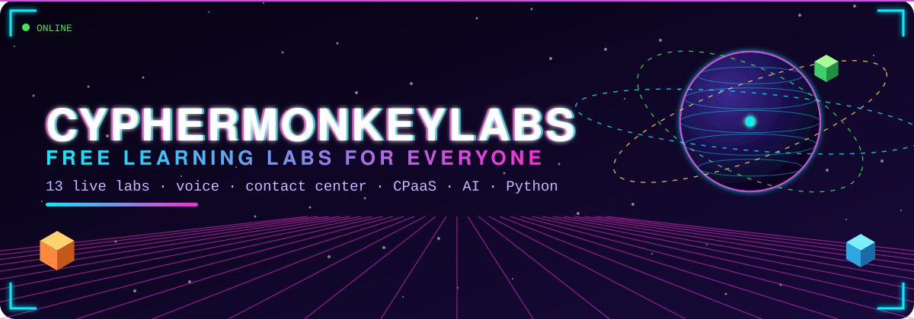
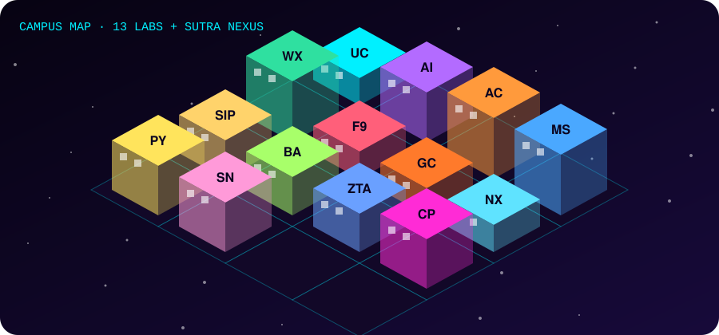
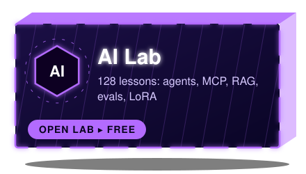
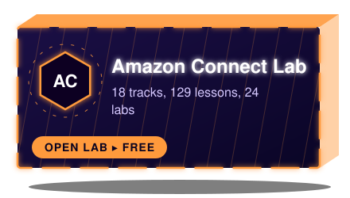
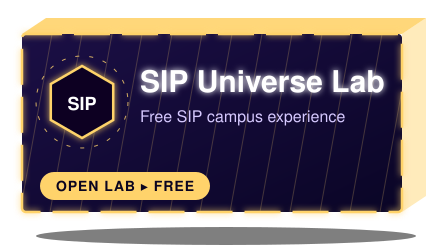
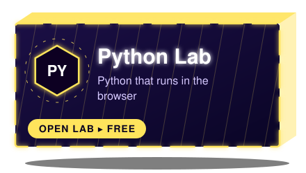
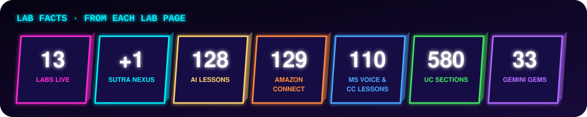
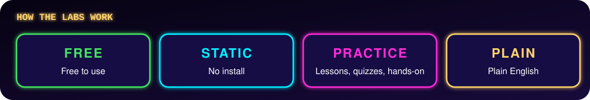
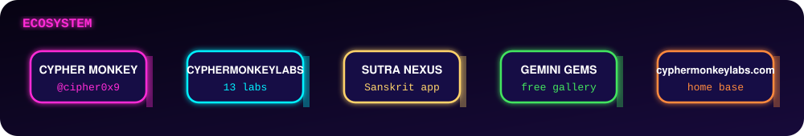

<picture><source media="(max-width: 600px)" srcset="assets/banner_org_mobile.svg"></picture>

  

 

   

## 🐒 About

Cypher Monkey Labs is the open lab of **Cypher Monkey**, a lifelong student and AI builder from systems, networking, voice and contact center, now growing into AI omni-channel agents. He learns by building, and he shares the work here, free for everyone.

<picture><source media="(max-width: 600px)" srcset="assets/monkey_org_mobile.svg"></picture>

The mascot cycles on its own: voice headset, network shades, student cap, AI visor, cloud, and agents.

## 🌌 The Universe

## 🧪 Thirteen Free Labs, Plus Sūtra Nexus

Each lab has a live app and a repo. The newest is Python Lab.

<table>
<tr><td align="center" width="50%"> 🚀 <a href="https://cyphermonkeylabs.com/uc-lab-free-university-mesmerizing/">Open app</a> · 📦 <a href="https://github.com/CypherMonkeyLabs/uc-lab-free-university-mesmerizing">View repo</a></td><td align="center" width="50%"> 🚀 <a href="https://cyphermonkeylabs.com/ai-lab-free-university-mesmerizing/">Open app</a> · 📦 <a href="https://github.com/CypherMonkeyLabs/ai-lab-free-university-mesmerizing">View repo</a></td></tr>
<tr><td align="center" width="50%"> 🚀 <a href="https://cyphermonkeylabs.com/amazon-connect-lab-free-university-mesmerizing/">Open app</a> · 📦 <a href="https://github.com/CypherMonkeyLabs/amazon-connect-lab-free-university-mesmerizing">View repo</a></td><td align="center" width="50%"> 🚀 <a href="https://cyphermonkeylabs.com/microsoft-voice-cc-lab-free-university-mesmerizing/">Open app</a> · 📦 <a href="https://github.com/CypherMonkeyLabs/microsoft-voice-cc-lab-free-university-mesmerizing">View repo</a></td></tr>
<tr><td align="center" width="50%"> 🚀 <a href="https://cyphermonkeylabs.com/webex-lab-free-university-mesmerizing/">Open app</a> · 📦 <a href="https://github.com/CypherMonkeyLabs/webex-lab-free-university-mesmerizing">View repo</a></td><td align="center" width="50%"> 🚀 <a href="https://cyphermonkeylabs.com/five9-lab-free-university-mesmerizing/">Open app</a> · 📦 <a href="https://github.com/CypherMonkeyLabs/five9-lab-free-university-mesmerizing">View repo</a></td></tr>
<tr><td align="center" width="50%"> 🚀 <a href="https://cyphermonkeylabs.com/genesys-cloud-lab-free-university-mesmerizing/">Open app</a> · 📦 <a href="https://github.com/CypherMonkeyLabs/genesys-cloud-lab-free-university-mesmerizing">View repo</a></td><td align="center" width="50%"> 🚀 <a href="https://cyphermonkeylabs.com/nice-cxone-lab-free-university-mesmerizing/">Open app</a> · 📦 <a href="https://github.com/CypherMonkeyLabs/nice-cxone-lab-free-university-mesmerizing">View repo</a></td></tr>
<tr><td align="center" width="50%"> 🚀 <a href="https://cyphermonkeylabs.com/sip-universe-lab-free-university-mesmerizing/">Open app</a> · 📦 <a href="https://github.com/CypherMonkeyLabs/sip-universe-lab-free-university-mesmerizing">View repo</a></td><td align="center" width="50%"> 🚀 <a href="https://cyphermonkeylabs.com/ba-lab-grok-free-university-mesmerizing/">Open app</a> · 📦 <a href="https://github.com/CypherMonkeyLabs/ba-lab-grok-free-university-mesmerizing">View repo</a></td></tr>
<tr><td align="center" width="50%"> 🚀 <a href="https://cyphermonkeylabs.com/zoom-talkdesk-avaya-lab-free-university-mesmerizing/">Open app</a> · 📦 <a href="https://github.com/CypherMonkeyLabs/zoom-talkdesk-avaya-lab-free-university-mesmerizing">View repo</a></td><td align="center" width="50%"> 🚀 <a href="https://cyphermonkeylabs.com/cpaas-lab-free-university-mesmerizing/">Open app</a> · 📦 <a href="https://github.com/CypherMonkeyLabs/cpaas-lab-free-university-mesmerizing">View repo</a></td></tr>
<tr><td align="center" width="50%"> 🚀 <a href="https://cyphermonkeylabs.com/python-lab-free-university-mesmerizing/">Open app</a> · 📦 <a href="https://github.com/CypherMonkeyLabs/python-lab-free-university-mesmerizing">View repo</a></td><td align="center" width="50%"> 🚀 <a href="https://cyphermonkeylabs.com/sutra-nexus/">Open app</a> · 📦 <a href="https://github.com/CypherMonkeyLabs/sutra-nexus">View repo</a></td></tr>
</table>

➕ More: <a href="https://cyphermonkeylabs.com/gemini-gems-free-gallery/">Gemini Gems</a>

## 🌟 How the labs work

## 🌐 Ecosystem

🌐 Ecosystem: <a href="https://cyphermonkeylabs.com">cyphermonkeylabs.com</a> → <a href="https://github.com/CypherMonkeyLabs">CypherMonkeyLabs</a> (13 labs) → <a href="https://cyphermonkeylabs.com/sutra-nexus/">Sūtra Nexus</a> → <a href="https://cyphermonkeylabs.com/gemini-gems-free-gallery/">Gemini Gems</a> · <a href="https://linktr.ee/CypherMonkey">linktr.ee/CypherMonkey</a>

## 🔗 Visit

  

 

⚠️ <b>Disclaimer:</b> independent educational projects. Not affiliated with, endorsed by, or sponsored by any vendor or product named here; all trademarks belong to their owners. Code is <b>MIT</b> licensed · written content is <b>CC BY-NC-SA</b>.

© 2026 CypherMonkeyLabs 🐒

