

<picture><source media="(prefers-color-scheme: dark)" srcset="assets/banner-dark.svg"><source media="(prefers-color-scheme: light)" srcset="assets/banner-light.svg"></picture>

<picture><source media="(prefers-color-scheme: dark)" srcset="assets/typing-dark.svg"><source media="(prefers-color-scheme: light)" srcset="assets/typing-light.svg"></picture>

    

   

<picture><source media="(prefers-color-scheme: dark)" srcset="assets/divider-dark.svg"><source media="(prefers-color-scheme: light)" srcset="assets/divider-light.svg"></picture>

## 🌌 Enter the Universe

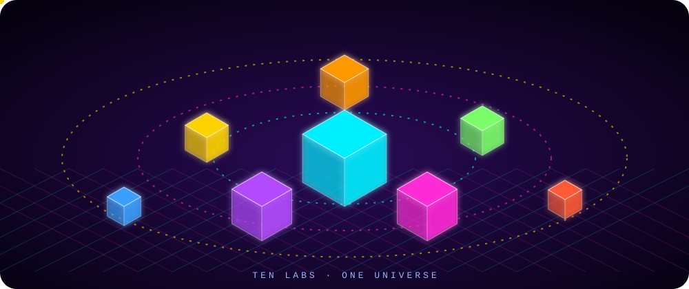

> 🐒 **CypherMonkeyLabs** is a free, hands-on university for the real-time communications world: unified communications, cloud contact centers, SIP, and applied AI. Open a lab, break things safely, learn fast. 🚀

<picture><source media="(prefers-color-scheme: dark)" srcset="assets/divider-dark.svg"><source media="(prefers-color-scheme: light)" srcset="assets/divider-light.svg"></picture>

## 🧪 The Ten Labs

<table>
<tr><td align="center"></td><td align="center"><a href="https://cipher0x9.github.io/ai-lab-free-university-mesmerizing/"></a></td></tr>
<tr><td align="center"><a href="https://cipher0x9.github.io/amazon-connect-lab-free-university-mesmerizing/"></a></td><td align="center"><a href="https://cipher0x9.github.io/microsoft-voice-cc-lab-free-university-mesmerizing/"></a></td></tr>
<tr><td align="center"><a href="https://cipher0x9.github.io/webex-lab-free-university-mesmerizing/"></a></td><td align="center"></td></tr>
<tr><td align="center"><a href="https://cipher0x9.github.io/genesys-cloud-lab-free-university-mesmerizing/"></a></td><td align="center"><a href="https://cipher0x9.github.io/nice-cxone-lab-free-university-mesmerizing/"></a></td></tr>
<tr><td align="center"><a href="https://cipher0x9.github.io/sip-universe-lab-free-university-mesmerizing/"></a></td><td align="center"></td></tr>
<tr><td align="center">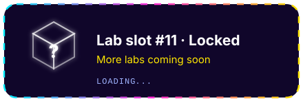</td><td align="center">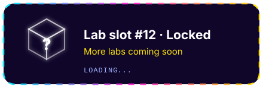</td></tr>
</table>

<picture><source media="(prefers-color-scheme: dark)" srcset="assets/divider-dark.svg"><source media="(prefers-color-scheme: light)" srcset="assets/divider-light.svg"></picture>

## 🎮 Guild Card


## 🏆 Achievements


## ⚡ Level Up

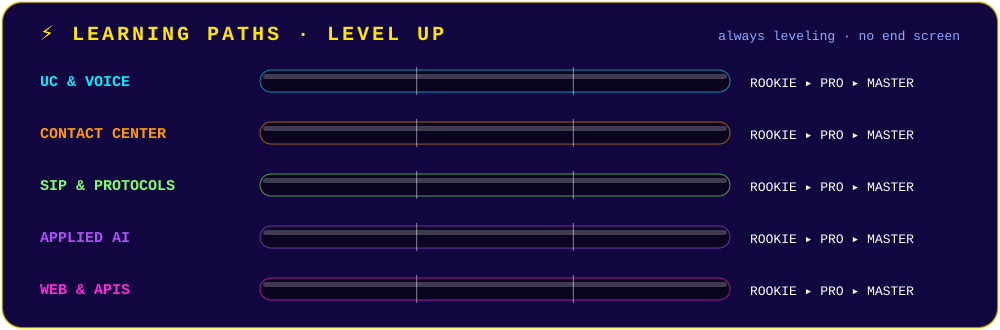

## 🛠️ Stack We Teach

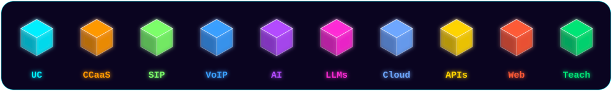

## 🧭 The Journey

<picture><source media="(prefers-color-scheme: dark)" srcset="assets/divider-dark.svg"><source media="(prefers-color-scheme: light)" srcset="assets/divider-light.svg"></picture>

## 🐒 Meet the Mascot

 Shades → headset → grad cap → crown → VR visor → ninja → astronaut → wizard. A new look every few seconds.

<picture><source media="(prefers-color-scheme: dark)" srcset="assets/divider-dark.svg"><source media="(prefers-color-scheme: light)" srcset="assets/divider-light.svg"></picture>

## 📡 Connect

    

  

  

⚠️ **Disclaimer:** independent educational projects. Not affiliated with, endorsed by, or sponsored by any vendor or product named here; all trademarks belong to their owners. Code is **MIT** licensed · written content is **CC BY-NC-SA**.

